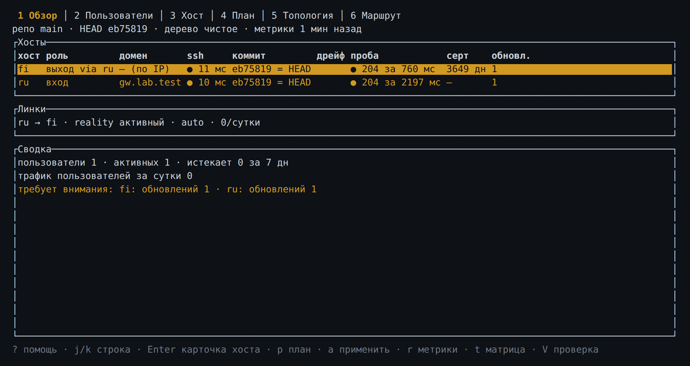
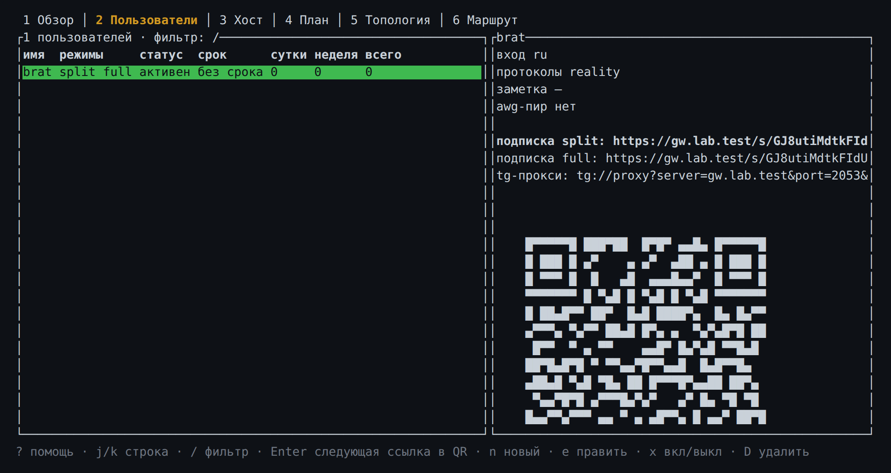
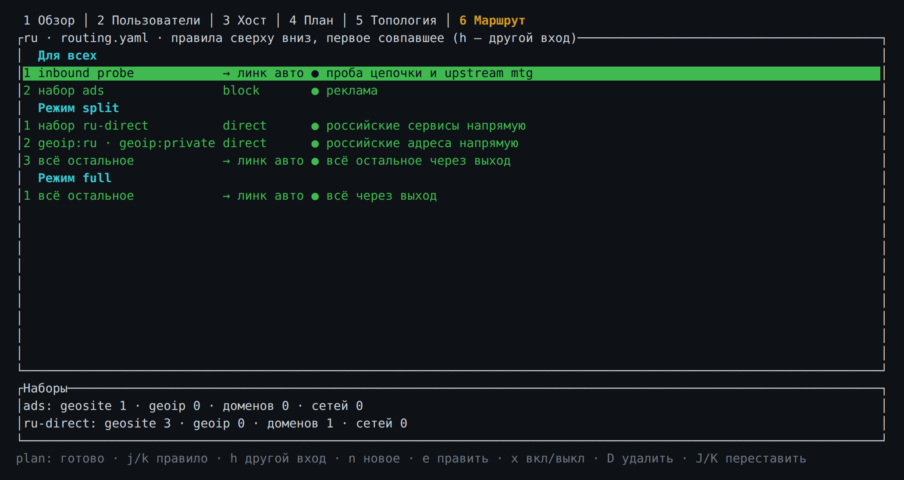
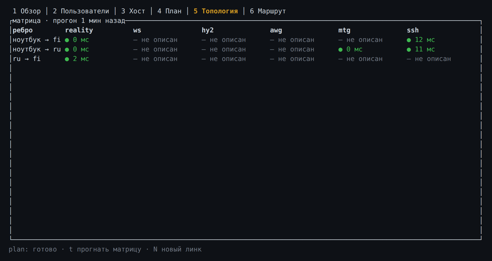
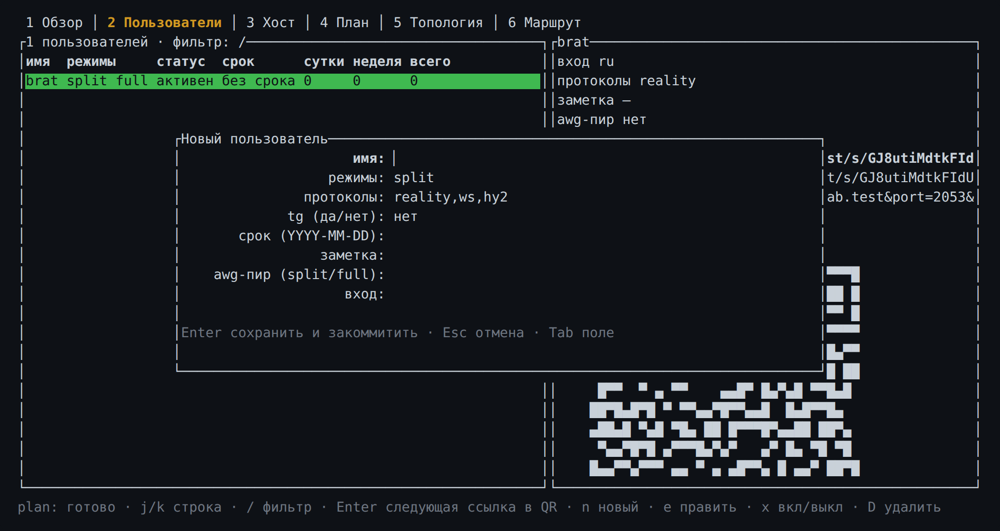
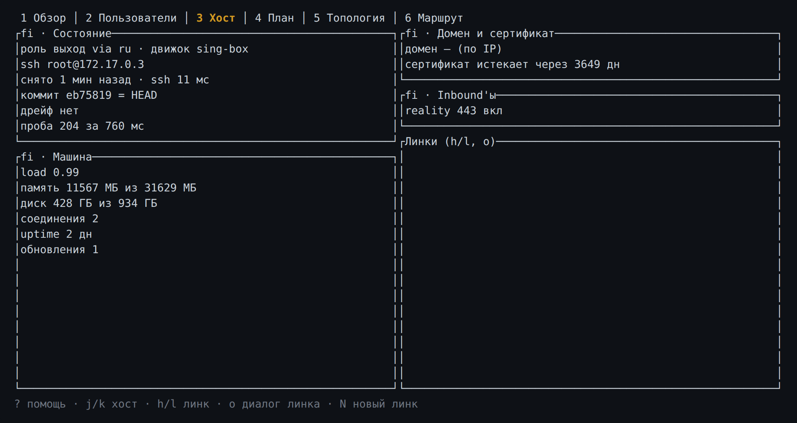
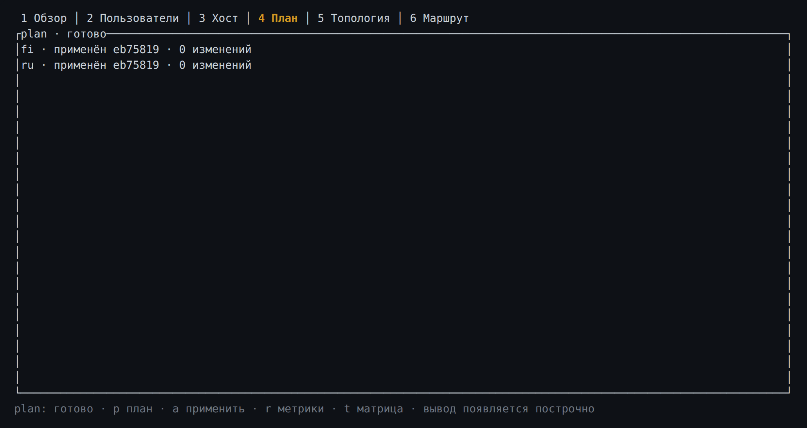
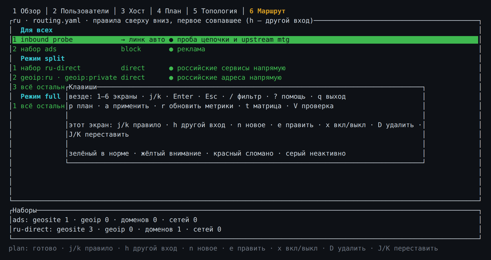

# vpnctl

**Your own VPN infrastructure as state in git.** An entry node in Russia with smart routing, exit nodes abroad, users and subscriptions — all in YAML files, applied over SSH, with no web panel and no agents on hosts.

  



<sup>The Overview screen on a two-container Docker lab. The interface is in Russian.</sup>

## Contents

- [How it works](#how-it-works)
- [Quick start](#quick-start)
- [Commands](#commands)
- [TUI](#tui)
- [State layout](#state-layout)
- [Hosts: bootstrap and templates](#hosts-bootstrap-and-templates)
- [Metrics and probes](#metrics-and-probes)
- [Verified on a lab](#verified-on-a-lab)
- [Development](#development)

## How it works


- **The source of truth is a state directory in git**: hosts, links, users, routing, domain sets, pinned versions, secrets via sops/age. Every state-changing command makes a commit.
- **Rendering is deterministic**: the state produces configs for sing-box/xray, Caddy, AmneziaWG, mtg, nftables, systemd and user subscriptions; two renders of the same state are byte-identical (`render --check`).
- **Applying is a push over SSH** from the laptop: `plan` shows the diff, drift and unreachable hosts; `apply` copies via stdin, checks configs, swaps them atomically, probes the chain and rolls back on failure. Exits are applied before the jump host.


- **Metrics are pulled over SSH** into a local SQLite: traffic per account and per outbound, machine state, certificates, chain probe, an "edge × protocol" matrix.
- **TUI and CLI are thin fronts** over one library crate; the logic lives in pure functions with tests.

Details are in [`docs/design.md`](docs/design.md) (Russian); specifications in [`openspec/specs/`](openspec/specs/).

## Quick start

```bash
cargo build --release
```

The state lives in a separate git repository. Create it and describe two hosts and a link between them:

```bash
vpnctl -C ~/vpn-state init --age age1...
```

```bash
vpnctl -C ~/vpn-state host add ru-msk-1 --ssh root@5.6.7.8 --domain gw.example.ru
```

```bash
vpnctl -C ~/vpn-state host add fi-hel-1 --ssh root@1.2.3.4 --role exit --via ru-msk-1
```

```bash
vpnctl -C ~/vpn-state link add ru-msk-1 fi-hel-1
```

Prepare the hosts, add a user and apply:

```bash
vpnctl -C ~/vpn-state host bootstrap ru-msk-1 && vpnctl -C ~/vpn-state host bootstrap fi-hel-1
```

```bash
vpnctl -C ~/vpn-state user add brat --modes split,full --awg split --tg
```

```bash
vpnctl -C ~/vpn-state render --check && vpnctl -C ~/vpn-state plan && vpnctl -C ~/vpn-state apply
```

Subscription links, QR codes, the Telegram proxy and the AWG profile for a user:

```bash
vpnctl -C ~/vpn-state user link brat --qr --tg --awg
```

Without `--age` secrets are stored in plain text. `--stub-secrets` lets CI run `validate` and `render --check` without a key. An example state is in [`tests/fixtures/basic`](tests/fixtures/basic).

## Commands

| Command | What it does |
|---|---|
| `vpnctl` / `vpnctl tui` | Interactive interface (default) |
| `init [--age <recipient>]` | Empty state and git repository |
| `validate` | Static check of the state |
| `render [--host] [--out] [--check]` | Configs into a directory; `--check` renders twice and compares bytes |
| `plan [--host] [--diff H P] [--adopt H P]` | What will change: diff, drift, unreachable; take a file from a host into `overrides/` |
| `apply [--host] [--branch] [--force]` | Apply over SSH with checks, probe and rollback |
| `collect` | Pull metrics and the chain probe into `metrics.sqlite` |
| `probe [--matrix]` | Chain probe from entries; matrix of edges per protocol |
| `status [--json]` | Summary from the database, no SSH |
| `host add/rm/bootstrap` | Hosts |
| `user add/edit/enable/disable/rm/link` | Users and their subscriptions |
| `link add/set` | Links between nodes: protocols, policy, active one |
| `exit set` | Exit selection policy for an entry |
| `set edit/rm` | Sets of domains, geosite, geoip |
| `rule add/edit/rm/move/toggle` | Routing rules in groups `all` / `split` / `full` |

Global flags: `-C <state dir>`, `--no-commit` for batch edits, `--stub-secrets`.

## TUI

`vpnctl -C ~/vpn-state` with no subcommand opens the interface. Six screens:

| Key | Screen | Shows |
|---|---|---|
| `1` | Overview | repo and HEAD, last `applied/*` tag, host table, links with per-protocol latency, exit policy, "direct / via exit" traffic summary, what needs attention |
| `2` | Users | traffic per day/week/total, card: entry, protocols, subscription links, Telegram proxy, QR |
| `3` | Host | state, machine, certificate, versions from `versions.yaml`, inbounds with user counts, exit, links |
| `4` | Plan/Apply | line-by-line output of `plan`, `apply`, `collect`, `probe --matrix`; apply guards in the title |
| `5` | Topology | static check and the "edge × protocol" matrix with colours |
| `6` | Routing | rule groups of the entry with set contents, engine default, DNS, sets |

One key layout everywhere:

| Everywhere | On an object | Operations |
|---|---|---|
| `j`/`k` rows · `Enter` open · `Esc` back | `n` new · `e` edit · `x` enable/disable · `D` delete | `p` plan · `a` apply (with confirmation) |
| `/` filter · `?` help · `q` quit | `J`/`K` move a rule · `o` link dialog · `h` another entry | `r` collect metrics · `t` matrix · `V` validate |

Colours: **green** — fine, **yellow** — needs attention (drift, behind HEAD, certificate < 14 days, pending updates, user expiring in < 7 days), **red** — broken, **grey** — inactive.

| Users with the subscription card and QR | Routing groups of the entry |
|---|---|
|  |  |

| Topology matrix | New user form with live validation |
|---|---|
|  |  |

| Host card | Plan output streamed on screen 4 |
|---|---|
|  |  |

Screenshots are from the two-container lab, captured with `tmux capture-pane`. Key help (`?`):



The user, rule and link dialogs are forms with the same values as the CLI. On every field change the operation and validation run on a copy of the state: the bottom of the form shows the upcoming commit message or the error, and for a rule the group as it will look. `Enter` performs the operation, validation, write and commit. Long operations run as a child `vpnctl`; their output streams onto screen 4 and the summary is reloaded when they finish.

Screen mockups live in [`screens/`](screens/): `npm i playwright && npx playwright install chromium`, then `node screens/check.js` renders them and catches overflows.

## State layout

```text
~/vpn-state/
├── hosts.yaml          role, engine, ip, domain, ssh, via
├── links.yaml          links: protocols, policy, active, awg tunnel
├── users.yaml          split/full modes, protocols, expiry, awg peer, tg
├── protocols.yaml      inbounds per host: ports, sni, paths, awg subnets
├── routing/<host>.yaml exit, rule groups all/split/full, dns
├── sets/<name>.yaml    sets: geosite, geoip, domains, networks
├── versions.yaml       pinned versions and sha256 of binaries
├── secrets.sops.yaml   keys, uuids, passwords — via sops/age
├── templates/          text config templates (override the built-in ones)
├── overrides/<host>/   files taken from a host with plan --adopt
└── metrics.sqlite      metrics (gitignored, 60-day retention)
```

User modes: **split** — Russian traffic direct, everything else via the exit; **full** — everything via the exit. For engine accounts the mode is a suffix in the email `<name>-<mode>-<protocol>`; for awg peers it is the subnet. Links always use the entry's domain, never its IP, so moving a node is invisible to users.

## Hosts: bootstrap and templates

`host bootstrap` idempotently prepares a host from the `bootstrap.sh.j2` template: packages and security repositories, unattended-upgrades with a reboot window, binaries pinned in `versions.yaml` with sha256 checks, sing-box rule-sets, AmneziaWG via DKMS, nftables and sysctl, units and a marker. Running it again finishes whatever is missing. The engine is chosen per host with the `engine` field (sing-box by default; xray without Hysteria2 and L3 clients).

The engine config is built in code; text configs (Caddy, AWG, mtg, nftables, systemd) come from templates. Templates in the state's `templates/` take priority over the built-in ones: after upgrading vpnctl, update them by hand or delete them to use the built-ins. A file taken from a host with `plan --adopt` lives in `overrides/<host>/` and is rendered as is.

## Metrics and probes

`collect` pulls everything from each host in one SSH call: traffic per account and per outbound (the engine's gRPC stats via `curl`), load, memory, disk, connections, uptime, pending updates, `reboot-required`, certificate expiry and the `generate_204` chain probe. Counter deltas are computed by the tool and written to `metrics.sqlite` next to the state. `probe` runs only the chain probe; `probe --matrix` adds the static check and the laptop→host and entry→exit edges per protocol as a table. `status [--json]` prints the summary from the database without touching hosts.

User traffic destinations and access logs are never collected.

## Verified on a lab

Two privileged Debian 13 containers with systemd and sshd, entry and exit through a jump host: `host bootstrap` → `plan` → `apply` → probe through the reality link → drift, `--diff`, `--adopt`; TUI — all screens, edits with commits, forms with live validation, `p` and `r` streaming. Without AWG (the kernel module cannot be built in a container), without ws/hy2 and certificates.

Known caveats: the official sing-box build lacks `v2ray_api`, so per-user statistics need a build with that tag (the config uses `clash_api`); a reality exit without a domain is covered by `sni` + `handshake: host:port` in `protocols.yaml`, and if the cover site is unreachable directly the server answers "processed invalid connection".

## Development

```bash
cargo test && cargo clippy --all-targets -- -D warnings && cargo fmt --check
```

- [`src/`](src/) — the library crate: `state`, `validate`, `render/`, `plan`, `apply`, `bootstrap`, `metrics`, `ops`, `tui/`; `main.rs` is the clap front.
- [`tests/`](tests/) — tests on pure functions and render snapshots (`insta`) on the `basic` fixture.
- [`openspec/`](openspec/) — specifications and archived changes for stages 1–6 (`add-state-model`, `add-render`, `add-apply`, `add-bootstrap`, `add-collect`, `add-tui`, `polish-tui`).
- [`docs/design.md`](docs/design.md) — the design: topology, state model, applying, screens and key layout (Russian).
