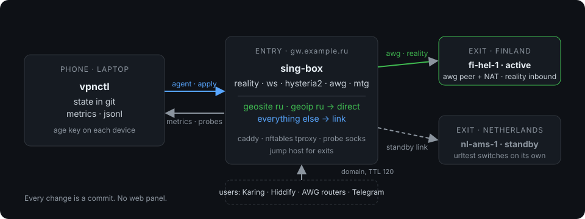
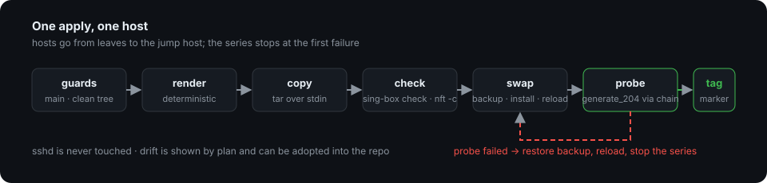
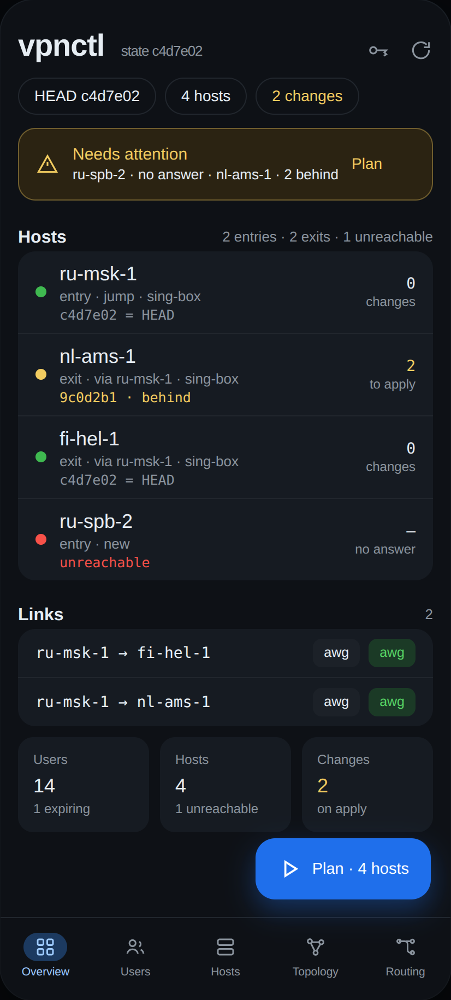
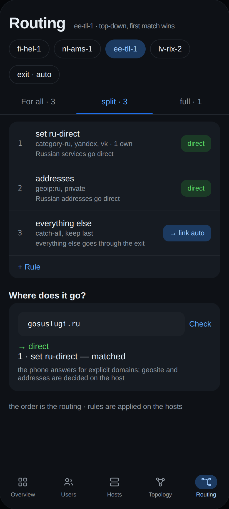
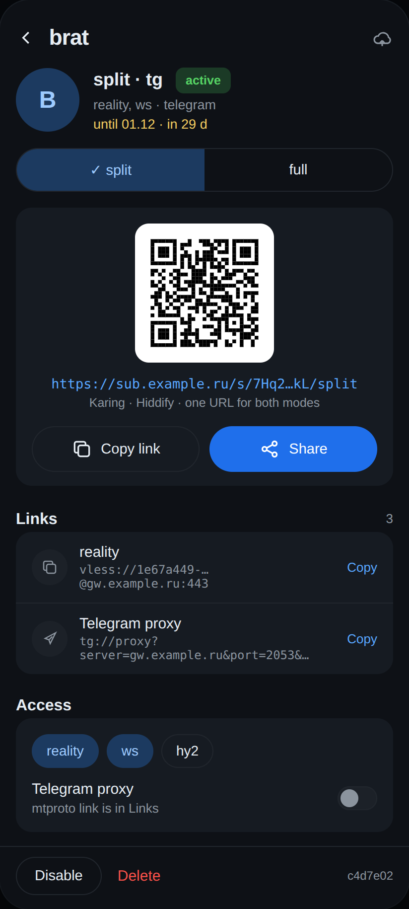

<div align="center">


# Your own VPN infrastructure, as state in git.

An entry close to home, exits abroad, users and subscriptions — YAML files in one repository, applied over SSH. The phone is the primary device; the CLI is the same operations for a laptop, and the interface an AI agent drives.

[](https://github.com/danilrwx/vpnctl/actions/workflows/ci.yml)
[](go.mod)
[](LICENSE)
[](https://github.com/danilrwx/vpnctl/releases/latest)
[](#what-it-does)<!-- coverage: generated by scripts/coverage.sh -->
[](#the-app)

[What it does](#what-it-does) · [Two ways in](#two-ways-in-one-core) · [A change travels](#a-change-travels-one-way) · [An agent](#an-agent-at-the-same-keyboard) · [The app](#the-app) · [Quick start](#quick-start) · [Releases](#releases) · [Commands](#commands)

</div>

## What it does

- **State is the truth.** `hosts.yaml`, `links.yaml`, `users.yaml`, routing and
  sets describe everything. Secrets live in one `secrets.age.yaml`, encrypted for
  every device you own plus an offline backup identity.
- **Render is deterministic.** Two runs produce identical bytes, and golden snapshots
  keep the renderer honest.
- **Apply is guarded.** Only a clean, pushed state is applied, only forward, with
  config checks before the swap, a chain probe after it, and a rollback when the
  probe fails.
- **The host is narrow.** `vpnctl-agent` takes one signed request, writes only
  under `/etc/` and `/var/www/sub/`, and can do nothing else. A phone can use it
  with a key that is restricted to that one command.
- **Handing out access is one command.** `vpnctl user message olga -lang ru`
  prints a ready-to-forward text; `user config` gives the same bytes the
  subscription endpoint serves.
- **Nothing to watch.** The entry runs the chain probe every minute, host metrics
  every five minutes, and the expiry tick every hour, from the same state. Alerts go to
  ntfy; there is no panel.

<p align="center">
  
  <br><sub>A phone and a laptop edit one state; the entry applies it; the exits carry the chain.</sub>
</p>

## Two ways in, one core

Every operation lives once in `ops`; the CLI and the gomobile API are thin
wrappers over the same functions. Change a user from the phone on the train, or
let an agent do it from a laptop.

| Phone | CLI | Agent |
|:--|:--|:--|
| The primary device: users, hosts, links, routing, plan and apply, with the QR code and the message at hand. Keys stay in the Keystore. | Flags instead of prompts, `--json` instead of prose, exit codes instead of dialogs. | The same commands from a shell. The laptop's own git, age and SSH keys do the work — there is no second identity to leak. |

```console
$ vpnctl plan -dir ./state
nl-ams-1 · applied 9c0d2b1 · 2 changes
  ~ etc/sing-box/config.json
  + var/www/sub/olga.txt
lv-rix-2 · ✗ ssh: connect: connection refused

$ vpnctl apply -dir ./state --host nl-ams-1
▸ nl-ams-1
  ✓ render · 2 files, 2 changes
  ✓ copied over the connection → /tmp/.vpnctl/
  ✓ check etc/sing-box/config.json
  ✓ atomic swap · services reloaded
  ✓ probe: 204 via fi-hel-1
  ✓ marker c4d7e02 written
```

## A change travels one way

The repository is the only input and the hosts are the only output. Nothing on a
host is edited by hand, and an apply that fails leaves the previous configuration
running.

<p align="center">
  
</p>

1. **Edit** — YAML and one secrets file, from the phone or the terminal.
2. **Commit** — secrets re-encrypted for every device you own, plus an offline
   identity.
3. **Plan** — diff against the hosts, drift and unreachable nodes, before anything
   moves.
4. **Apply** — over SSH, leaves first; the configuration is checked before the
   swap.
5. **Probe** — the entry handshakes with each exit end to end. If it fails, roll
   back.

`clean & pushed` · `forward only` · `validate before swap` · `probe after swap` ·
`rollback on failure`

## An agent at the same keyboard

The CLI is non-interactive by construction: flags instead of prompts, JSON instead
of prose, exit codes instead of dialogs.

```console
$ vpnctl user rotate olga
✓ users: olga: rotate credentials

$ vpnctl apply -dir ./state --json
{
  "error": {
    "code": "guard",
    "message": "HEAD c4d7e02 is not pushed: origin/main is 9c0d2b1 — push first, then apply (or --unpushed)"
  }
}
$ echo $?
3

$ git push origin main
$ vpnctl apply -dir ./state --json
{"branch": "main", "head": "c4d7e02", "hosts": [ … ]}
$ echo $?
0
```

- **JSON and exit codes.** Every command takes `--json`, errors included. `0` ok ·
  `1` failed · `2` bad flags · `3` guard refused: pull or ask, do not retry.
- **The laptop's keys.** git, age and SSH belong to the machine the agent runs on.
  It has no recipient of its own in `age.yaml`.
- **No questions.** A missing flag is an error with exit 2, not a prompt; the CLI
  never waits for input.

## The app

The phone is the primary device: the overview, users and their links, hosts,
topology, routing, plan and apply, devices and keys. Compose over a gomobile AAR
that Gradle rebuilds from `mobile/` on every build, so a Go change cannot hide
behind a stale binding.

<p align="center">
  
  &nbsp;&nbsp;
  
  &nbsp;&nbsp;
  
  <br><sub>Overview · Routing · User card — three of the screens, at 412 × 915</sub>
</p>

The build needs the Android SDK with an NDK, Go, `gomobile` and Gradle 8.10.

```sh
go install golang.org/x/mobile/cmd/gomobile@latest && gomobile init   # once
cd app && gradle test         # the parsers, on the JVM
cd app && gradle assembleDebug

adb install -r app/build/outputs/apk/debug/app-debug.apk
```

A release build takes its signing from the environment; without a keystore it
falls back to the debug key, which is a local check and not a release:

```sh
VPNCTL_KEYSTORE=/path/to/release.jks \
VPNCTL_KEYSTORE_PASSWORD=… VPNCTL_KEY_ALIAS=… VPNCTL_KEY_PASSWORD=… \
VPNCTL_VERSION_CODE=42 VPNCTL_VERSION_NAME=0.2.0 \
  gradle assembleRelease
```

CI builds the debug APK on every change (`.github/workflows/ci.yml`) and has a
manual release workflow that signs with repository secrets.

## Quick start

```bash
go build -o ~/.local/bin/vpnctl ./cmd/vpnctl
go build -o ~/.local/bin/vpnctl-agent ./cmd/vpnctl-agent

vpnctl init -dir ./state --name laptop --backup   # skeleton + age.yaml, asks for a passphrase
vpnctl key add phone age1…                        # a second device
vpnctl host add edge --role exit --ssh root@203.0.113.10
vpnctl host bootstrap edge                        # packages and engines
vpnctl plan  -dir ./state                         # what differs
vpnctl apply -dir ./state                         # install it
```

Building the CLI needs Go alone. The app build needs the Android SDK with an NDK,
Go, `gomobile` and Gradle 8.10.

## Releases

Every release carries the signed APK, the CLI for Linux and macOS (amd64 and
arm64), the agent for Linux (amd64 and arm64), and `sha256sums.txt`. The asset
names are stable, so the `latest` URLs keep working.

```sh
# the CLI, on a laptop
curl -LO https://github.com/danilrwx/vpnctl/releases/latest/download/vpnctl_linux_amd64.tar.gz
tar xzf vpnctl_linux_amd64.tar.gz
install -m0755 vpnctl ~/.local/bin/

# the agent, on a host
curl -LO https://github.com/danilrwx/vpnctl/releases/latest/download/vpnctl-agent_linux_amd64.tar.gz
tar xzf vpnctl-agent_linux_amd64.tar.gz
install -m0755 vpnctl-agent /usr/local/bin/
```

The APK is `vpnctl.apk` (64-bit ARM) or `vpnctl-armv7.apk` (32-bit ARM); the
same release key signs every update, so an installed app updates in place.
Verify an asset against `sha256sums.txt` before installing it.

## Commands

| command | what it does |
|:--|:--|
| `init` | a state from zero: skeleton, `age.yaml`, the first commit |
| `key add\|rm\|list` | who can read the secrets, re-encrypted on every change |
| `check` | static validation, the same rules `apply` enforces |
| `render` | the config tree, byte for byte |
| `plan` | diff, drift, unreachable hosts, with `--diff` and `--adopt` |
| `apply` | install, leaves first, with probe and rollback |
| `host add\|bootstrap\|rm` | the node lifecycle |
| `host agent-install` | put the agent on a host, restrict the key to it |
| `user add\|rm\|list` | accounts with fresh credentials |
| `user renew` | extend a term, from today or from the current date |
| `user disable\|enable\|edit` | switch an account off, change modes, protocols, expiry, note |
| `user rotate` | new uuid, passwords and peer: a leaked link stops working |
| `user link\|message\|config` | what the person actually receives |
| `metrics` | the host history the entry collects |
| `probe` | the topology matrix: every link and protocol, handshaken on the entry |
| `alerts set\|show\|off\|test` | where the entry reports a broken chain; `--serve` runs ntfy on the entry |
| `state status` | head, origin and the marker of every host |
| `state fmt` | two spaces everywhere, `--check` to fail instead of rewrite |
| `versions check` | newest upstream release per pin, `--breaking` to exit 1 |
| `versions auto` | pull in patch updates: pin, sha256, commit, push, `--apply` to deploy |
| `versions pin` | sha256 of every pinned release |
| `completion` | the shell completion script |

Every command accepts `--json`; a guard refusal exits `3`, a bad flag exits `2`.
`render`, `plan`, `apply` and `host bootstrap` take `--at`, the day expiry is
measured against, today in UTC by default.

## Layout

```
cmd/vpnctl          the CLI
cmd/vpnctl-agent    the narrow executor installed on a host
internal/           state, render, validate, plan, apply, agent, bootstrap,
                    ops, cli, gitsync, remote, ageio
mobile/             gomobile API for the Android app
testdata/           the fixture and the golden snapshots
app/                the Android app: Compose UI over the gomobile AAR
docs/design.md      the design, the decisions and the trade-offs
```

Nothing outside the module can import `internal/`; `mobile` stays public because
`gomobile bind` generates code that imports it.

## Design

The design, the decisions and the trade-offs are in
[`docs/design.md`](docs/design.md).

## License

Apache 2.0, see [LICENSE](LICENSE). Contributions: [CONTRIBUTING.md](CONTRIBUTING.md).

The Android app bundles two fonts, both under the SIL Open Font License 1.1:
Inter (© The Inter Project Authors) and JetBrains Mono (© The JetBrains Mono
Project Authors). The license texts ship inside the APK in
`app/app/src/main/assets/licenses/`; the fonts are unmodified, so the reserved
names and the copyright notices are left as they are.
