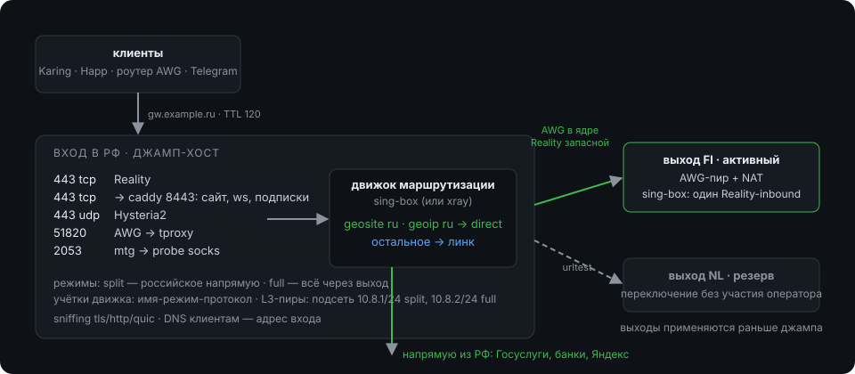

# vpnctl — дизайн утилиты управления VPN-инфраструктурой

Статус: черновик по итогам обсуждения, обновлён 2026-11-01. Ядро перенесено на Go (репозиторий `vpnctl-go`), приложение Android — на первом месте: телефон становится основным устройством, ноутбук — вторым.

## 1. Цель и границы

`vpnctl` — ядро на Go с CLI и мобильным приложением для одного оператора: держит несколько VPS (входы в России и выходы за границей) в состоянии, описанном в git, и раздаёт доступ десяткам пользователей без веб-панели. Приложение — интерфейс человека; CLI — интерфейс ИИ-агента оператора и самого оператора, когда тот работает руками (раздел 16). На хостах — узкий агент с белым списком действий (раздел 13), не веб-панель и не произвольный шелл.

Делает:

- хранит описание хостов, линков, протоколов, наборов доменов и пользователей в репозитории; секреты — в одном `secrets.age.yaml`, зашифрованном на всех устройствах оператора;
- детерминированно рендерит конфиги xray/sing-box, веб-сервера, AmneziaWG, mtg и применяет их через агент на хосте с валидацией, пробой и откатом;
- выпускает пользователям подписки, файлы профилей (`awg.conf`, `wg.conf`, `.ovpn`), ссылки `tg://proxy`, QR;
- собирает минимальные метрики, проверяет живость цепочки и матрицу протоколов между узлами;
- делает bootstrap нового хоста одной командой и переезд ноды, невидимый для пользователей.

Осознанно не делает в v1: лимиты трафика с автоотключением, HWID, Telegram-бот, веб-интерфейс, несколько операторов, автоприменение без коммита. Агент на хосте — не pull-агент: он ничего не делает сам, только исполняет подписанный запрос. Нужны ли ему действия по таймеру, решается в разделе 18.

## 2. Целевая топология



Два слоя на входе: терминаторы протоколов (inbound'ы движка; AWG, WG и OpenVPN как интерфейсы) и один движок маршрутизации, в который всё сливается. L3-туннели заворачиваются в движок через nftables tproxy, домены восстанавливает sniffing (tls/http/quic), DNS клиентам пушится адрес входа.

Режимы пользователя: `split` (российское напрямую, остальное через выход) и `full` (всё через выход). Для учёток движка режим — часть email `<имя>-<режим>-<протокол>` (`brat-split-reality`); правило режима в рендере перечисляет все email'ы этого режима, движок сравнивает email точно. Для L3-пиров режим задан подсетью: у AWG `10.8.1.0/24` = split и `10.8.2.0/24` = full, у WG `10.8.3.0/24` и `10.8.4.0/24`, у OpenVPN `10.8.5.0/24` и `10.8.6.0/24`.

Клиентские протоколы: VLESS через Reality, VLESS через WebSocket за Caddy, Hysteria2, trojan, AWG, WG, OpenVPN и mtg для Telegram.

Обычный WireGuard (`wg`) нужен для роутеров и клиентов без AmneziaWG: MikroTik, Keenetic на старых прошивках, стандартное приложение WireGuard. Отдельного демона нет: это второй интерфейс того же модуля amneziawg, `wg0` на своём UDP-порту, с выключенной обфускацией (`Jc`, `Jmin`, `Jmax`, `S1`, `S2` = 0, `H1`–`H4` = 1–4). В таком режиме AmneziaWG совместим с WireGuard. Параметры обфускации общие для интерфейса, поэтому AWG и WG живут на разных интерфейсах. Дальше трафик WG идёт тем же путём, что у AWG: tproxy в движок, режим по подсети. Сигнатура WireGuard узнаваема, поэтому это запасной путь: участок клиент → вход внутренний, но работу проверяют из реальных сетей, мобильные операторы ведут себя по-разному. Между нодами WG не используется, там остаётся AWG.

OpenVPN нужен там, где нет ни AmneziaWG, ни WireGuard: старые Keenetic и MikroTik, ноутбуки со штатным клиентом. Это отдельный демон `openvpn` 2.6 из пакетов дистрибутива, интерфейс `tun`; дальше трафик идёт тем же путём, что у AWG: tproxy в движок, режим по подсети. Сервер слушает UDP на своём порту; TCP на другом порту включается флагом на inbound для клиентов без UDP. CA один на всё состояние, поэтому сертификат пользователя подходит ко всем его входам; сертификат сервера у каждого входа свой. Ключи и сертификаты выпускает ядро (`crypto/x509`) и хранит в секретах; удалённые пользователи попадают в CRL, который рендерится на каждый вход. `tls-crypt` шифрует управляющий канал и отсекает чужие подключения, но от DPI OpenVPN не прячет: это запасной путь, как `wg`.

Trojan нужен клиентам без VLESS: старый Clash, часть клиентов iOS и роутеров. Inbound trojan в движке стоит за Caddy и работает поверх WebSocket на 443, как `ws` у VLESS: TLS терминирует Caddy, путь свой. Пароль — на пользователя, учётка `<имя>-<режим>-trojan`. Какие клиенты понимают trojan поверх WebSocket, проверяется на стенде; если транспорт не подойдёт, trojan получит свой TCP-порт с сертификатом от Caddy, как Hysteria2.

Движок задаётся полем `engine` хоста в `hosts.yaml`, по умолчанию sing-box: Hysteria2 внутри, tproxy-inbound, rule-set, urltest, DNS-сервер для L3-клиентов. xray — только если важен xhttp за CDN; Hysteria2 и DNS-сервер на нём недоступны, валидация это отвергает. Между нодами — AWG в ядре, движок кидает трафик в интерфейс.

Входов может быть несколько, у разных хостеров и в разных сетях. Тогда при блокировке одного входа пользователи уходят на другой без переезда. Каждый вход самостоятельный: свой домен и сертификат, свои ключи Reality, свои inbound'ы, свой `routing/<вход>.yaml` и свои линки к выходам. Выходы общие.

- **Входы пользователя.** Пользователь перечисляет входы в `entries`, первый — основной. `entry` остаётся краткой формой для одного входа. Если входов в состоянии несколько, список обязателен; приложение при создании пользователя отмечает все.
- **Учётки.** На каждом входе те же email `<имя>-<режим>-<протокол>`, тот же UUID, пароли hy2 и trojan. `user rotate` меняет их на всех входах сразу.
- **Профиль клиента.** В профиле серверы всех входов пользователя, теги `<вход>-<протокол>`. Сначала протоколы основного входа, потом остальных: Clash-группа `fallback` держит этот приоритет, `urltest` в sing-box берёт самый быстрый из живых. Клиент переживает блокировку входа, даже не обновив подписку.
- **Подписка.** Файлы подписки лежат на всех входах пользователя. Адрес подписки — на общем домене `subscription.domain` в `hosts.yaml`; его A-запись смотрит на один вход и переключается при блокировке. Сертификат для общего домена Caddy получает на том входе, куда смотрит DNS, остальные — после переключения. Короткий разрыв касается только обновления подписки: VPN работает по уже скачанному профилю.
- **L3-пиры.** Адрес и ключ пира одинаковы на всех входах, конфиги отличаются только `Endpoint` и ключом сервера. AWG и WG не переключают `Endpoint` сами, поэтому роутеру при блокировке входа приложение выдаёт конфиг другого входа. OpenVPN переключается сам: в `.ovpn` перечислены все входы пользователя строками `remote`, основной первым.
- **Telegram и приглашение.** mtg работает на каждом входе. В приглашении одна ссылка подписки, прямые ссылки и `tg://proxy` — по основному входу.
- **Проверки.** `validate` требует, чтобы на каждом входе пользователя были включены его протоколы и у каждого входа был выход. Домены входов различны, подсети L3 на разных входах могут совпадать.
- **Пробы и метрики** идут по каждому входу; матрица топологии — по всем парам «вход → выход» с линком.

Служебный socks-inbound `probe` на входе — общий для пробы цепочки и для upstream mtg; его трафик идёт по правилу «для всех» в линк авто, поэтому Telegram через mtg всегда уходит за границу.

## 3. Модель состояния (git)

```
hosts.yaml       хосты: имя, роль (entry/exit), engine (sing-box/xray), ip, домен, via (ssh-джамп), ssh host key, retiring;
                 что записал bootstrap: ОС и версия, ядро, виртуализация, архитектура; общий домен подписки
links.yaml       направленные линки между нодами: протоколы, политика выбора протокола (auto/fixed/rr), для auto — предпочтение и urltest (интервал, порог, число ошибок)
protocols.yaml   inbound'ы хостов: reality (sni, handshake host:port), ws, trojan (путь), hy2, awg, wg и openvpn (порты, подсети split/full), mtg, включённость
users.yaml       пользователи: имя, входы (первый — основной), режимы, протоколы, срок, enabled, пиры awg, wg и openvpn (адрес в подсети режима), tg
routing/<host>.yaml  правила по группам (для всех / split / full), DNS, выбор выхода: политика (auto/fixed), предпочтительный линк, urltest
sets/*.yaml      наборы доменов и IP: geosite/geoip-категории + свои записи
versions.yaml    версии и sha256 по архитектурам (amd64, arm64): sing-box/xray, geodata, caddy, mtg, amneziawg; openvpn — только версия пакета
alerts.yaml      куда слать оповещения: ntfy-топик и, если сервер свой, хост, который его держит
secrets.age.yaml  шифртекст: UUID, ключи Reality + shortIds, пароли hy2 и trojan, ключи AWG и WG, CA и сертификаты OpenVPN, ключ tls-crypt, секрет mtg, subId, токен оповещений
age.yaml         получатели secrets.age.yaml: устройства оператора и офлайн-бэкап
templates/       шаблоны (.j2) вшиты в бинарник; одноимённый файл в состоянии перекрывает шаблон для всех хостов
overrides/<host>/<путь>  файл, взятый с хоста через `plan --adopt`; рендер кладёт его вместо своего
```

Домен может повторяться у двух хостов только на время переезда, когда у старого стоит `retiring: true`; иначе валидация считает дубль ошибкой.

Наборы `sets/` общие для всех входов. Правка набора меняет маршрутизацию на каждом входе, где он используется, и `plan` показывает все такие хосты.

Принципы: одна сущность — один файл; линк описывается один раз и рендерится на обе стороны; вся «личность» ноды (ключи, UUID, пути) живёт в состоянии, а не рождается на хосте — поэтому переезд ноды = bootstrap + apply + DNS.

## 4. Рендер и детерминированность

- Рендер чистый: без времени, случайностей, с сортированными ключами. Два прогона дают одинаковые байты (CI проверяет).
- Версии движков, geodata, Caddy и mtg пинятся в `versions.yaml` с sha256; `apply` сверяет хэши на хосте. Обновление geodata — коммит, не фон.
- Секреты генерируются один раз командами (`user add`, `link add`) и читаются при рендере. Расшифровка только в памяти, ключ age — на устройстве оператора (раздел 12).
- Состояние на хосте выводимо из коммита: маркер `/etc/vpnctl/applied-commit` + хэши файлов.

## 5. Применение

Модель: применяет оператор, и первым устройством обычно становится телефон. Облачный CI без секретов только валидирует (рендер с заглушками, `sing-box check`, воспроизводимость).

`plan`: рендер → один запрос к агенту хоста (`op: plan`: маркер, флаг bootstrap, хэши путей) → диф, дрейф (ручные правки), недоступные хосты.

`apply` для каждого хоста по порядку от листьев к джамп-хосту: guard'ы → рендер → один запрос к агенту (`op: apply`: дерево файлов и коммит). Агент сам делает проверки синтаксиса до подмены, атомарную замену с бэкапом, перезапуски в фиксированном порядке, пробу `generate_204`; провал на любом шаге — откат из бэкапа и остановка серии. По завершении — тег `applied/<дата>`, маркер — из подписанного коммита, а не из ответа хоста.

Guard'ы:

- чистое дерево;
- ветка `main` (или `--branch` явно);
- после fetch HEAD = `origin/main`;
- маркер каждого хоста — предок HEAD;
- сертификат есть на хосте до выкатки конфига веб-сервера;
- выбранный протокол линка отвечает по матрице.

Применяется только запушенное и только вперёд:

- **Запушено.** Перед apply устройство делает fetch и требует HEAD = `origin/main`. Порядок всегда «коммит → пуш → apply»; отвергнутый пуш означает «сначала pull». Так состояние хостов всегда совпадает с тем, что видят все устройства, а маркер указывает на коммит, который есть в удалённом репозитории. Тег `applied/<дата>` пушится после серии.
- **Только вперёд.** Маркер хоста должен быть предком HEAD. Если нет, другое устройство уже применило более новое состояние, и устройство со старым откатило бы хосты; apply отказывает и просит pull. Откат делается новым коммитом (`git revert`), а не применением старого.
- **Блокировка.** Агент принимает один apply за раз и отвечает «занят» на второй. Две серии с телефона и ноутбука не перемешаются.
- **Аварийный выход.** `apply --unpushed` для случая, когда удалённый репозиторий недоступен. Маркер получает пометку `unpushed`, и `plan` на других устройствах предупреждает о коммите, которого у них нет, пока его не запушат.

Джамп-хост: `via` у хоста определяет порядок (листья первыми). Транспорт — нативный SSH в приложении и ядре (`x/crypto/ssh`), цепочка джампов проходится по одному соединению на хост; `ssh -J` и системный `ssh` остаются для break-glass и bootstrap.

## 6. Bootstrap и среда выполнения вне git

Bootstrap (идемпотентный, по шаблонам): security-репозитории, `unattended-upgrades` + таймер с окном перезагрузки (вход и выходы в разные ночи), nftables (наружу только 443 tcp/udp, порты mtg, awg, wg и openvpn, ssh с известных адресов; tproxy для L3), sysctl (BBR, forwarding), sing-box или xray + geodata с проверкой sha, amneziawg-dkms, openvpn, mtg, веб-сервер с встроенным ACME, агент и ключи устройств в `authorized_keys`, systemd-юниты, маркер bootstrap.

Сертификаты: Caddy (или Angie, если нужен nginx-синтаксис и DNS-01 без токенов) выпускает и обновляет сам. TLS терминирует веб-сервер, а ws, trojan и подписки стоят за ним на localhost. Reality движок держит сам на 443 tcp и отдаёт чужие рукопожатия Caddy. Утилита мониторит срок и даёт кнопку «обновить сейчас». Для Hysteria2 файл сертификата читается из каталога веб-сервера.

Обновления ОС и перезагрузки — автоматически на хосте; утилита показывает ожидающие обновления, `reboot-required`, последний прогон, и умеет «обновить сейчас» и «перезагрузить» в порядке apply.

## 7. Пользователи и подписки

Пользователь → учётки `<имя>-<режим>-<протокол>` в движке, один UUID. Подписка — статический файл на каждом входе пользователя (`/var/www/sub/<subId>/{split,full}`), base64-список `vless://`, `hysteria2://`, `trojan://` + заголовки `profile-title`, `profile-update-interval`, `subscription-userinfo`; рядом варианты sing-box JSON / Clash YAML по User-Agent. Две ссылки = две группы в Karing с автовыбором протокола внутри. Порядок протоколов у пользователя задаёт приоритет. В Clash-профиле группа `fallback`: берётся первый живой протокол по порядку. В профиле sing-box типа группы с приоритетом нет, поэтому там `urltest`, он выбирает самый быстрый из живых. В base64-списке автовыбора нет. Голые ссылки — только там, где естественны: `awg.conf`, `wg.conf` или `.ovpn` + QR для роутеров, `tg://proxy` (mtg, общий секрет, upstream — socks движка), «показать как vless://».

Приглашение — готовый текст для пересылки: ссылка подписки, прямые ссылки, `tg://proxy`, подсказка по клиентам. Язык берётся из системы, `--lang ru|en` его меняет; форматы `text` и `markdown`. `user config` выдаёт тот же набор как ссылки, base64-подписку, профиль sing-box или Clash — для проверки и для ручной раздачи.

## 8. Метрики, пробы, матрица топологии

Pull через агент в локальную SQLite устройства, ретеншн ~2 месяца. Где хранить историю, когда устройств несколько и основное — телефон, решается в разделе 18.

- трафик по пользователям и outbound'ам из stats API движка (дельты считает утилита). Решение: `sing-box tools` не умеет опрашивать `v2ray_api`, `grpcurl` — лишний бинарник и `.proto` на хосте, `clash_api` даёт только живые соединения; поэтому `collect` делает gRPC-вызов `QueryStats` обычным `curl --http2-prior-knowledge` (POST пяти нулевых байт на `/v2ray.core.app.stats.command.StatsService/QueryStats`), хост отдаёт ответ в base64, утилита разбирает protobuf сама (varint + length-delimited, ~30 строк). Один путь для sing-box (`127.0.0.1:8080`) и xray (`127.0.0.1:10085`). Сброс счётчика при перезапуске движка — дельта равна новому показанию; итоги «всего» копятся отдельно и не подпадают под ретеншн;
- хост: load, память, диск, соединения, uptime, обновления, срок сертификата;
- проба цепочки: `curl --socks5-hostname 127.0.0.1:1080 https://www.gstatic.com/generate_204` на входе;
- матрица топологии: рёбра устройство→вход, устройство→выход, вход→выход. В v1 (`probe --matrix`) с устройства — tcp-коннект к TCP-inbound'ам и время `ssh`, с входа — tcp-коннект для reality/hy2 (подтверждает хост, не протокол) и возраст рукопожатия awg и wg (`awg show latest-handshakes`, порог 180 с) с RTT до второго адреса туннеля. Утилита как настоящий клиент каждого протокола (временные конфиги в tmpfs, нужен движок на устройстве) и пробник внутри РФ (роутер/телефон отдаёт JSON на вход) — отложены;
- статическая проверка состояния: граф via без циклов, у входа есть выход, ключи линков совпадают, подсети не пересекаются.

Не собираем: адреса назначения пользователей, access-лог движка.

## 9. CLI

Общий флаг `-C <каталог состояния>`. `--json` у всех команд — в плане (раздел 16).

Есть в vpnctl-go:

```
vpnctl check [--stub] [--warnings]          # валидация состояния; --stub — заглушки вместо секретов
vpnctl render [--out <dir>] [--host <h>] [--stub]
vpnctl plan [--host <h>] [--diff <host>:<path>] [--adopt <host>:<path>]
vpnctl apply [--host <h>] [--branch <b>] [--force]
vpnctl user add <name> [--modes split,full] [--protos reality,ws,hy2,awg] [--tg] [--entry <host>] [--nocommit]
vpnctl user rm <name> [--nocommit]
vpnctl user list
vpnctl user edit <name> [--modes split,full] [--protos reality,ws] [--tg|--no-tg] [--expires YYYY-MM-DD] [--note <text>]
vpnctl user disable|enable <name>             # выключить и включить, не трогая доступы
vpnctl user renew <name> --days 30|--until YYYY-MM-DD   # продлить срок от более поздней даты
vpnctl user rotate <name>                     # новые uuid, subId, пароли и пир
vpnctl key backup --out <file>                # зашифрованная резервная идентичность
vpnctl key restore <file>
vpnctl alerts set --ntfy <url> [--token-file <f>]   # чужой топик
vpnctl alerts set --serve <host> --topic <name>      # свой ntfy на входе
vpnctl alerts show|off|test
vpnctl probe [--host <вход>] [--timeout 5]          # матрица: каждое ребро × протокол
vpnctl versions check [--breaking]              # что нового наверху; --breaking — код 1 на minor/major
vpnctl versions auto [--apply]                  # патчи: пин, sha256, коммит, push; --apply — ещё и на хосты
vpnctl --version | vpnctl-agent --version       # ревизия сборки из build info
vpnctl user link <name>                       # ссылки и подписки
vpnctl user message <name> [--format text|markdown] [--mode] [--lang ru|en] [--ip] [--no-links] [--no-tg]
vpnctl user config <name> [--mode] [--format links|sub|singbox|clash] [--out <path>]
vpnctl completion <shell>
```

В плане:

```
vpnctl init [--remote <url>] [--fresh]     # скелет + age.yaml; --fresh перезаписывает историю
vpnctl key init|add|rm|list [name] [age1…]  # получатели secrets.age.yaml, перешифровка
vpnctl host add|bootstrap|rm <name> [--ssh root@ip] [--via <host>]
vpnctl user add … [--entries a,b] [--awg] [--wg] [--ovpn]   # --entries заменяет --entry
vpnctl user link <name> [--qr] [--awg] [--wg] [--ovpn]
vpnctl link add|set <from> <to> [--active awg] [--policy auto|fixed|rr]
vpnctl exit set <host> [--prefer <link>] [--policy auto|fixed]
vpnctl set edit <name>            # наборы доменов/IP
vpnctl rule add|edit|rm|move      # маршрутизация
vpnctl render --check             # два прогона, побайтовое сравнение
vpnctl apply --unpushed
vpnctl collect | probe [--matrix] | status
vpnctl import 3x-ui <db>
```

## 10. Стек

Go: `x/crypto/ssh` (нативно, без системного `ssh`), `go-git`, `nikolalohinski/gonja` (шаблоны `.j2`, совместимы с minijinja), `filippo.io/age`, `gopkg.in/yaml.v3`, `urfave/cli/v3` (CLI и автодополнение), `gomobile bind`. Приложение — Android (Kotlin + Compose поверх сгенерированных биндингов).

Раскладка идиоматичная для Go: в `cmd/` только два тонких `main` — `vpnctl` и `vpnctl-agent`; всё остальное под `internal/`, чтобы никто снаружи модуля не мог импортировать; `mobile/` публичный, потому что сгенерированный `gomobile` код импортирует его извне модуля.

Rust-ядро больше не нужно: bootstrap перенесён, снапшоты рендера и случаи валидации живут в тестах Go (раздел 17), скрипт bootstrap совпал побайтово. vpnctl-go занимает место репозитория vpnctl; Rust остаётся в истории как источник эталонов. Пакет `sopsio` удалён, миграция `secrets.sops.yaml` в `secrets.age.yaml` выполнена; старые состояния переводятся `sops -d` и `age -e` один раз и уходит вместе с последним состоянием на sops. Служебные `cmd/gtest` и `cmd/opsprobe` — отладка, не часть продукта.

Ключи: три роли — git (деплой-ключ на репозиторий), секреты (X25519 для age), доступ к хостам (SSH к агенту). Приватные части устройств живут в Android Keystore или в приватном хранилище приложения; на хостах только публичные (раздел 12).

## 11. Этапы

Сделано в Go:

- состояние; `age.yaml` с несколькими получателями и резервной идентичностью под паролем; `init`, `key add|rm|list`;
- рендер: побайтово совпал с эталоном Rust, и эталоны теперь лежат в `testdata/snapshots` — тест `go test ./render/` сравнивает их, `-update` перезаписывает;
- валидация: полный паритет с Rust плюс таблица случаев в тестах;
- plan и apply через нативный SSH, с `--diff` и `--adopt`; guard'ы «только запушенное и только вперёд», `--unpushed`;
- bootstrap: скрипт совпал с Rust байт в байт, `host bootstrap [--print]` и `host add`;
- CLI пользователя: `add`, `rm`, `list`, `link`, `message` (ru/en), `config`; автодополнение;
- gomobile API: пользователи, ссылки, приглашение, добавление пользователя, sync;
- миграция секретов с sops на age;
- CI: `go vet`, `go test`, `gofmt`, `check --stub`, двойной `render --stub` с побайтовым сравнением.

Дальше, по порядку:

1. Агент на хостах: `plan`/`apply` по узкому протоколу, белый список путей, `host agent-install` ставит бинарь и запирает ключ на forced command. Сделано; остался режим `tick` для сроков и ротации.
2. Приложение и CLI: экраны обзора, плана, применения, пользователей, устройств; ключи в Keystore, репозиторий через deploy key. Паритет операций приложения и CLI, `--json` у всех команд (раздел 16).
3. Метрики и обслуживание: таймеры пробы и метрик хоста сделаны, история на входе (раздел 18). Осталось: трафик по пользователям, матрица топологии.
4. Остальной цикл: учёт трафика, обновление движков, вывод хоста (раздел 15).
5. Несколько входов (раздел 2): `entries` у пользователя, профиль и подписка со всеми входами, общий домен подписки.
6. Протоколы для роутеров и старых клиентов (раздел 2): `wg`, OpenVPN, trojan; конфиги, QR и `.ovpn` для пользователя.
7. Совместимость (раздел 14): таблица возможностей по версиям, бинарь движка в составе apply, профили по версии клиента, матрица ОС и виртуализации в bootstrap и `validate`.
8. Отложено: L3-протоколы кроме AWG, WG и OpenVPN (IKEv2, SSTP), пробник внутри РФ, балансер выходов, двухфазное применение серии, MCP-сервер.

## 12. Устройства и ключи

Роли ключей разделены, смешивать их нельзя:

| роль | где приватная часть | кому публичная | зачем |
|---|---|---|---|
| git | Android Keystore (ECDSA P-256) | деплой-ключ на репозиторий с правом записи | тянуть и пушить состояние |
| секреты | X25519 в приватном хранилище приложения под обёрткой Keystore | получатель в `age.yaml` | расшифровать `secrets.age.yaml` |
| доступ к хостам | Android Keystore (ECDSA P-256) | `authorized_keys` на нодах | запросы к агенту |

`age` умеет шифровать файл сразу нескольким получателям, поэтому телефон не забирает чужой ключ, а становится вторым адресатом того же файла. `age.yaml` в корне репозитория:

```
recipients:
  - name: laptop
    key: age1…
  - name: phone
    key: age1…
  - name: backup
    key: age1…      # приватная часть нигде не лежит: только дамп под паролем
```

Онбординг, три сценария:

1. **Пустой репозиторий, первый девайс.** Устройство генерирует X25519 и два ключа Keystore, показывает три публичные строки, пишет скелет состояния с `age.yaml` из одного получателя, коммитит и пушит. Если удалённый репозиторий уже содержит коммиты — это не «с нуля», а клонирование.
2. **Репозиторий есть, добавляем устройство.** Новое устройство генерирует свою идентичность и показывает строку `add:<name> age1…`; существующее устройство выполняет `key add`, перешифровывает секреты на всех и пушит. Приватный ключ не путешествует, отзыв устройства — `key rm` с перешифровкой.
3. **Перенос идентичности (восстановление).** Идентичность шифруется парольной фразой (`age` scrypt) и показывается строкой или QR; импорт на другом устройстве. Аварийный путь: после него общая копия должна быть заменена собственным устройством через сценарий 2, иначе отзыв невозможен.

Резервная идентичность `backup` создаётся при инициализации: её получатель сразу попадает в `age.yaml`, а приватная часть выдаётся один раз зашифрованной под пароль и хранится вне устройств (бумага, менеджер паролей). Это единственный способ прочитать секреты, если потеряны все устройства.

Честное ограничение: идентичность `age` нельзя положить в Keystore — Keystore умеет ECDSA/RSA, а age использует X25519. Приватная часть лежит в приватном хранилище приложения, защищённом шифрованием устройства и обёрткой из Keystore; это не hardware-backed, и это надо помнить.

Отзыв устройства: `key rm <name>` → перешифровка; отозвать деплой-ключ в GitHub; убрать ключ из `authorized_keys`; проверить, что второе устройство всё ещё рендерит. Новая запись в истории git не защищает старые коммиты — они остались зашифрованы на прежний набор получателей.

Ограничения выбора при `init`: репозиторий с историей — выбор «подключиться» (клонировать, проверить, что устройство есть среди получателей) или «начать заново» (скелет поверх, force-push). Перед force-push старая верхушка уезжает в ветку `backup/pre-init-<дата>`, а хеш удалённой ветки сверяется повторно — аналог `--force-with-lease`. После «начать заново» маркеры на хостах указывают на коммиты, которых в истории нет, и `plan` сообщает об этом до первого apply.

## 13. Агент на хосте

Узкий привилегированный исполнитель: принимает дерево файлов и коммит, применяет, отчитывается. Никакого произвольного шелла, никакого pull-режима — агент сам ничего не инициирует. Разделы 15.2 и 15.3 хотят от хоста действий по таймеру; как это совместить с агентом, решается в разделе 18.

Протокол — JSON в stdin, JSON в stdout:

```
{ "v": 1, "op": "plan" | "apply" | "mark" | "probe" | "read" | "metrics" | "cert", "host": "<имя>", "commit": "<хеш>",
  "tree_hash": "…", "ts": 0, "nonce": "…",
  "files": [{ "path": "/etc/sing-box/config.json", "sha256": "…", "mode": 384, "body": "<base64>" }],
  "sig": "…" }
```

`plan` возвращает маркер, флаг bootstrap и хэши запрошенных путей; `apply` — статус по файлам, код пробы и признак отката; `mark` двигает маркер и манифест без прочих изменений (так телефон применяет серию без шелла). `read` отдаёт содержимое файлов **только из `applied.sha256`** — манифест и есть белый список, иначе подписанный запрос читал бы любой `/etc/`; `metrics` — последние строки `/var/lib/vpnctl/metrics/*.jsonl`; `cert` — сертификаты Caddy из `/var/lib/caddy/.local/share/caddy/certificates`. Все три появились ради экранов телефона и ограничены своими каталогами. Ошибки типизированы (`signature`, `stale`, `replay`, `path`, `check`, `probe`, `io`), чтобы клиент решал, повторять запрос или останавливать серию.

Проверки до любого действия: версия протокола, имя хоста совпадает с собственным (дерево для входа нельзя влить на выход), `|now − ts| ≤ 300`, nonce не повторялся, подпись ECDSA P-256, `tree_hash` совпадает с содержимым файлов.

Белый список путей — не формальность: агент работает от root, поэтому разрешены только `/etc/` и `/var/www/sub/`, режимы только `0600`/`0644`, пути без `..`, отказ на симлинках в цепочке, отказ на setuid. Это превращает «агент от root» в «агент, который умеет ровно одну вещь».

Одно исключение — бинари движков для обновления в составе apply (раздел 14). Они ложатся только в `/opt/vpnctl/bin/` с режимом `0755` и именем с версией: `sing-box-1.14.4`. Агент сверяет sha256 с `versions.yaml` из того же подписанного дерева. Юнит в `/etc/systemd/system` ссылается на полный путь, поэтому откат — это прежний юнит, без симлинков. После успешной пробы агент удаляет старые версии, кроме предыдущей.

Подпись: запрос подписывает ключ доступа к хостам того устройства, которое применяет (раздел 12). На телефоне это ECDSA P-256 в Keystore, ключ не покидает аппаратное хранилище; на ноутбуке — файл ключа. На хосте лежат только публичные части устройств. Хост не может быть скомандован: ему можно только подсунуть дерево, подписанное ключом, которого у него нет.

Транспорт в два этапа, протокол один:

- **A.** forced command в sshd: `restrict,no-pty,command="/usr/local/bin/vpnctl-agent"` в `authorized_keys`. Одно соединение, JSON в stdin, ответ в stdout. Новых портов нет, файрвол не меняется, работает и с телефона (SSH в приложении нативный).
- **B.** демон за Caddy на входе: HTTPS на существующем домене и сертификате, сокет — unix. Для выходов релей на входе; релей подделать запрос не может, конечный агент проверяет подпись сам.

Что остаётся на SSH навсегда: bootstrap нового хоста (агента ещё нет), break-glass при мёртвом агенте, диагностика.

## 14. Совместимость версий и платформ

Каждый компонент закреплён в `versions.yaml`, и рендер пишет конфиг под закреплённую версию, а не под «последнюю». Правила:

- **Окно версий.** Рендер знает поддерживаемый диапазон для каждого движка. `validate` отвергает закрепление вне окна.
- **Таблица возможностей.** Различия версий описаны одной таблицей «компонент, версия → возможность», а не копиями шаблонов. Пример строки: sing-box ≥ 1.14 — явный `http_clients` для удалённых rule-set.
- **Бинарь едет вместе с конфигом.** Смена версии движка — часть apply: агент кладёт новый бинарь в `/opt/vpnctl/bin/` (раздел 13), проверяет новый конфиг новым бинарём, откатывает оба. Сейчас бинарь ставит bootstrap, и между ним и apply конфиг и бинарь могут не совпасть.
- **CI проверяет движком.** `render --check` на заглушках плюс `sing-box check` и `xray -test` закреплённых версий.
- **Повышение версии — отдельный коммит.** `plan` показывает смену версии отдельной строкой. Перед повышением читается список устаревшего у движка.

### Известные конфликты

| где | конфликт | решение |
|---|---|---|
| sing-box на хостах | Удалённые rule-set без явного HTTP-клиента устарели в 1.14 и исчезнут в 1.16, а поля `http_clients` нет в 1.12. Один конфиг не годится для обеих версий. | Рендер выбирает форму по закреплённой версии хоста. Разные версии на разных хостах допустимы. |
| sing-box, профиль клиента | Сейчас профиль минимальный: outbounds и route. Обёртки Karing и Hiddify добавляют свой TUN и DNS, а официальные приложения sing-box без них не работают. Полный профиль зависит от версии: DNS сменил формат в 1.12, `stack` у TUN устарел в 1.15. | Два варианта: фрагмент для обёрток и полный профиль для официальных приложений, по версии из User-Agent. |
| Ядра обёрток | Karing и Hiddify живут на своих форках sing-box и отстают от основной ветки. Поле из новой версии ломает импорт всего профиля. | Профиль для обёрток пишется подмножеством полей, стабильным с 1.11. Каждая новая версия приложения проверяется на стенде. |
| Clash | Правило `*lash*` в Caddy ловит и старый Clash, который не знает VLESS, Reality и Hysteria2. Такой клиент отвергает весь профиль. | YAML отдаётся только семейству mihomo: mihomo, clash.meta, FlClash, Clash Verge. Остальным base64. Плюс явный `?fmt=singbox\|clash\|plain` в адресе подписки на случай ошибки. |
| Линк между движками | Протокол должен быть в обоих движках: xhttp есть только в xray, Hysteria2 и DNS-сервер только в sing-box. | Уже проверяется `validate`. Обобщить до таблицы возможностей по движку и версии. |
| AmneziaWG 1.0 и 2.0 | Параметры 2.0 (`S3`, `S4`, диапазоны в `H1`–`H4`, `I1`–`I5`) ломают клиентов и роутеры на 1.0. Конфиг 1.0 клиенты 2.0 понимают. | Уровень задаётся на интерфейсе, по умолчанию 1.0. Уровень 2.0 живёт на отдельном интерфейсе, как `wg`. `validate` сверяет уровень с версией модуля из `versions.yaml`. |
| Xray | Новые возможности Reality и VLESS, например постквантовые ключи и шифрование VLESS, требуют свежих клиентов. | По умолчанию выключены. Включение — флаг на inbound с пометкой в форме «нужны клиенты не старше …». |
| Ссылки base64 | Не все клиенты на ядре xray понимают `hysteria2://`. | Hysteria2 остаётся в подписке, а в приглашении для таких клиентов указаны протоколы, которые у них точно работают. |
| Trojan | Не все клиенты, знающие trojan, умеют его поверх WebSocket. | Проверка на стенде. Если транспорт не подойдёт, trojan получает свой TCP-порт с сертификатом Caddy. |
| OpenVPN | Клиенты 2.4 не знают `data-ciphers`. У MikroTik RouterOS 6 только TCP. | Сервер 2.6: `data-ciphers AES-256-GCM:AES-128-GCM:CHACHA20-POLY1305`, `data-ciphers-fallback AES-256-CBC`. TCP-порт — флаг на inbound. Что умеют RouterOS 7 и Keenetic, проверяется на стенде. |

### Матрица дистрибутивов

Bootstrap читает `/etc/os-release`, версию ядра, `systemd-detect-virt` и архитектуру и записывает их в `hosts.yaml`. `validate` сверяет хост с матрицей, bootstrap отказывается ставиться на неподдерживаемое.

| ОС | ядро | модуль AWG | nftables tproxy | автообновления | статус |
|---|---|---|---|---|---|
| Debian 13 | 6.12 | dkms | да | unattended-upgrades | основная цель, на ней стенд |
| Debian 12 | 6.1 | dkms | да | unattended-upgrades | поддерживается; обычная поддержка Debian закончилась в июне 2026, дальше LTS |
| Ubuntu 24.04 | 6.8 | dkms из PPA | да | unattended-upgrades | поддерживается |
| Ubuntu 22.04 | 5.15 или 6.8 HWE | dkms из PPA | да | unattended-upgrades | поддерживается до конца обычной поддержки, апрель 2027 |
| Ubuntu 26.04 | 7.0 | проверить сборку dkms | да | unattended-upgrades | после проверки на стенде |
| Alma, Rocky, CentOS | — | — | — | — | нет: dnf и SELinux, отдельная ветка шаблонов не окупается |
| Alpine | — | — | — | — | нет: без systemd |

Виртуализация важнее дистрибутива:

| виртуализация | что работает | ограничения |
|---|---|---|
| KVM, Xen, VMware, Hyper-V | всё | — |
| OpenVZ, LXC | движок, Caddy, mtg | своего ядра нет: модуль AWG не собрать, tproxy часто недоступен. AWG только через `amneziawg-go` в пространстве пользователя, L3-клиенты (`awg`, `wg`) на таком входе выключены, линки — Reality и Hysteria2. `validate` это проверяет. |

Архитектуры: amd64 и arm64. Движки, Caddy и mtg — статические бинари под обе, поэтому sha256 в `versions.yaml` хранится для каждой архитектуры отдельно.

## 15. Полный цикл обслуживания

Уже закрыто: состояние и история в git, рендер, `plan` с дрейфом, apply с пробой и откатом, подписки. ОС обновляется сама (`unattended-upgrades` из bootstrap), сертификаты продлевает Caddy; от vpnctl нужен только статус. На хостах нет данных, которые надо бэкапить: всё восстанавливается из состояния.

Чего не хватает, по порядку важности:

1. **Bootstrap на Go.** Новый хост сейчас умеет ставить только Rust-ядро. Пока bootstrap не перенесён, Rust удалять нельзя.
2. **Оповещения.** Метрики собираются, только когда оператор открыл приложение или запустил `collect`; блокировку входа ночью первыми заметят пользователи. Агент на входе по таймеру гоняет пробу цепочки и пробу каждого протокола линка с нагрузкой: скачать ~256 KB с выхода, а не только 204, потому что обрыв после первых десятков килобайт крошечная проба не видит. Провал протокола линка агент обходит сам, переключая группу через `clash_api` без смены конфига и git. Сообщение уходит в Telegram-бот или ntfy: адрес — в `alerts.yaml`, токен — в секретах. Кто запускает пробу по таймеру, решается в разделе 18.
3. **Истечение срока пользователей.** Срок есть в `users.yaml`, но отключает пользователя только apply. Агент получает сроки вместе с деревом и в срок сам выключает учётки и подписку; `plan` показывает это как ожидаемое расхождение, а не дрейф.
4. **Перевыпуск ключей пользователя.** Ссылка утекла — одна операция `user rotate <имя>`: новый UUID, subId, пароли hy2 и trojan, пир AWG/WG, сертификат OpenVPN (старый — в CRL), коммит, apply, новое приглашение.
5. **Учёт трафика.** `collect` берёт статистику через `v2ray_api`, а в официальной сборке sing-box его нет. Без своей сборки с тегом `with_v2ray_api` трафика по пользователям нет, и лимиты строить не на чем. Решение: своя сборка в `versions.yaml` с sha256 или xray на входе; до этого экраны показывают трафик только по outbound'ам.
6. **Замена заблокированного входа.** Второй живой вход (раздел 2) снимает срочность: пользователи уже на нём, замену можно делать спокойно. Поток есть: новый хост с тем же доменом, старый `retiring`. DNS переключается вручную, автоматизация — через API DNS-провайдера, когда надоест. Приглашение подставляет IP в прямые ссылки, поэтому при смене IP `plan` перечисляет пользователей с такими ссылками, а приложение предлагает переслать приглашение. Подписки по домену переживают переезд сами.
7. **Обновление движков.** Уведомление о новой версии, проверка по разделу 14, закрепление в `versions.yaml` отдельным коммитом, выкатка серией; бинарь едет в составе apply.
8. **Вывод хоста из работы.** `host rm` убирает хост из линков и маршрутов, проверяет, что ни один вход не остался без выхода, удаляет ключ доступа с хоста; DNS и сам VPS — руками или агентом оператора через CLI хостера.

## 16. CLI для ИИ-агента и API для приложения

Приложение — интерфейс человека. CLI — интерфейс ИИ-агента оператора (Claude Code и подобных) и самого оператора, когда тот работает руками. Агент не нажимает кнопки, поэтому всё, что умеет приложение, умеет и CLI.

- **Один реестр операций.** Операции живут в ядре (`ops`), а CLI и gomobile API — тонкие обёртки над ними. Логика не дублируется. Тест сверяет, что каждая операция есть в обоих интерфейсах.
- **Неинтерактивность.** Без вопросов и псевдографики, всё через флаги. Подтверждение опасного действия — флаг `--yes`, а не запрос в терминале.
- **`--json` у каждой команды.** Схема стабильная. Ошибка тоже JSON: `{"error": {"code": "...", "message": "..."}}`, где `code` совпадает с типами ошибок агента (раздел 13) и guard'ов (раздел 5).
- **Коды выхода.** `0` — успех, `1` — ошибка, `2` — неверные аргументы, `3` — отказ guard'а: не запушено, хост впереди HEAD, дрейф, агент занят. По коду `3` ИИ-агент понимает, что нужен pull или решение человека, а не повтор.
- **ИИ-агент может всё, включая apply.** Защита та же, что у человека: guard'ы, `plan` перед `apply`, проба и откат, история в git.
- **Ключи.** ИИ-агент работает на ноутбуке и пользуется его ключами: git, age и доступ к хостам. Своего получателя в `age.yaml` у него нет. Коммиты ИИ-агента помечаются трейлером `Via: claude-code`, история и `plan` показывают их отдельно. Свой ключ и запись в `age.yaml` нужны, только если агент переедет в облако, CI или на сервер.
- **MCP** — позже и поверх того же реестра операций, если CLI станет мало.

API для приложения — `mobile.App` через `gomobile bind`, тонкая обёртка над `ops`: `Open`, `Users`, `Links`, `Share`, `Message`, `AddUser`, `EditUser`, `RmUser`, `SetEnabled`, `Renew`, `Protocols`; `Plan`, `Apply`, `ApplyProgress`, `Push`, `Pull`, `Head`, `RepoState`, `Diff`, `Adopt`; `Devices`, `AddDevice`, `RemoveDevice`, `NewBackup`, `SetAlerts`, `Alerts`; `Hosts`, `HostLinks`, `AddHost`, `EditHost`, `Inbounds`, `ToggleInbound`; `AddLink`, `SetLink`; `Routing`, `AddRule`, `RemoveRule`, `MoveRule`, `ToggleRule`, `RouteTest`; `Metrics`, `Certs`. Всё, что меняет состояние, пишет файлы, валидирует и коммитит — как соответствующая команда CLI.

## 17. Тесты и CI

- **Эталоны рендера.** Фикстура и снапшоты лежат в `testdata/` vpnctl-go как золотые файлы; `go test ./render/` сравнивает рендер побайтово, флаг `-update` перезаписывает. Отдельный тест повторяет вариант «вход на xray». Снапшоты сделаны ядром Rust и Go воспроизводит их без изменений — это и есть доказательство паритета.
- **Валидация.** Таблица в тестах `validate`: мутация состояния → ожидаемая ошибка; проверяются все правила раздела, включая предупреждения.
- **CI** на каждый пуш, без секретов: `go vet`, `go test ./...`, `golangci-lint`, `gofmt -l`, `vpnctl check --stub`, `vpnctl render --stub` дважды с побайтовым сравнением, `coverage.sh --check`. Мобильные тесты фикстуры теперь сами создают age-ключ в `t.TempDir()`: раньше они падали на раннере, который не имеет `~/.config/sops/age/keys.txt`.
- **Android в CI.** Отдельный job ставит JDK 17, SDK (platform 35, build-tools 34, NDK 26.1), `gomobile init`, Gradle 8.10.2 и запускает `gradle test` и `assembleDebug`. Проверки `sing-box check` и `xray -test` закреплённых версий — следующий шаг, им нужны бинари в образе.
- **Релиз.** `assembleRelease` подписывается ключом из окружения (`VPNCTL_KEYSTORE`, пароли, alias, `VPNCTL_VERSION_*`); без ключа падает в debug-подпись. Ручной workflow `release.yml` берёт те же значения из секретов и загружает APK артефактом.
- **Стенд.** Контейнеры с Debian 13 для bootstrap, apply и проверки клиентов: какие клиенты принимают профиль, trojan поверх WebSocket, OpenVPN на роутерах.

## 18. Решённые вопросы

### Действия на хосте по таймеру

Решение: **systemd**, вариант А. Агент остаётся «только по запросу», периодическая работа живёт в юнитах.

- Проба цепочки — `vpnctl-probe.timer`, раз в минуту, на входе: 204 через socks движка; иначе одно оповещение в ntfy. Скрипт `/etc/vpnctl/probe.sh`, топик и токен — `/etc/vpnctl/alerts.env` (0600), в скрипт не попадают. Сообщений ровно три вида: поломка (переход ok→fail), напоминание раз в 30 минут, пока цепочка лежит, и восстановление. Состояние пробы — `/var/lib/vpnctl/probe.state`, по нему скрипт отличает переход от повтора; без него каждый падающий запуск слал бы сообщение, 1440 в сутки.
- Топик задаётся командой `vpnctl alerts set --ntfy https://ntfy.sh/vpnctl-xxxx` и попадает в `alerts.yaml`; токен читается из `--token-file`, трубы или скрытого приглашения и уходит только в секреты. `alerts test` отправляет одно сообщение сейчас, `alerts show` печатает топик и хосты, с которых идут оповещения, `alerts off` выключает их.
- **Свой ntfy на входе.** `alerts set --serve <вход> --topic <имя>` пишет в `alerts.yaml` и топик, и хост, а публичное имя выводится из домена входа: `https://ntfy.<домен>/<имя>`. Сервер слушает только `127.0.0.1:2586`; наружу его выводит Caddy сайтом `https://ntfy.<домен>:8443 { bind 127.0.0.1 }` — туда же попадает обычный TLS-клиент, потому что reality сплайсит всё, что не прошло проверку, на `handshake.dest`, а это Caddy. Отдельного порта и отдельного сертификата не нужно: Caddy берёт его у Let's Encrypt через tls-alpn-01. Веб-интерфейс выключен, токена в первой версии нет — секрет топика это его имя, случайные 12 hex-символов. В `alerts.env` рядом с публичным адресом лежит loopback-адрес, и проба шлёт по нему: иначе сломанный ingress глушит оповещение о сломанном ingress. `alerts test` проверяет публичный путь с машины оператора, а путь пробы доказывает сам `apply`, который после свопа гоняет пробу цепочки.
- **Юнит не стартует сам.** `bootstrap` ставит и включает юниты, но не запускает их: конфига на хосте ещё нет. Поэтому `apply` после daemon-reload добивает все юниты из рендера, которые не менялись: `systemctl is-active --quiet X || systemctl start X`. Иначе сервис, у которого единственный файл — это его юнит, ждал бы следующей правки конфига.
- Метрики хоста — `vpnctl-metrics.timer`, раз в 5 минут: load, память, диск, uptime, соединения, флаг перезагрузки. Пишет JSON-строку в `/var/lib/vpnctl/metrics/<месяц>.jsonl`, хранит два месяца.
- Оба юнита рендерятся из состояния, ставятся обычным `apply` и откатываются как любой файл. Секретов, кроме токена оповещений, на хосте не появляется.

Истечение срока пользователя (§15.3) сделано агентом: `vpnctl-agent tick` и `vpnctl-tick.timer` раз в час на входе. Ротация ключей (§15.4) остаётся командой оператора, а не таймером: она меняет ссылки людей и требует раздачи.

**Обновления.** `versions check` спрашивает у GitHub последний релиз через редирект `/releases/latest` — без токена и без лимита API — и говорит размер шага. Патч тянется сам (`versions auto`: пин, sha256, коммит, push, с `--apply` — обычный apply с guard'ами), минор и мажор меняют язык конфига, который мы рендерим, поэтому только отчёт: в репозитории состояния на это заведён ежедневный workflow, который заводит одно issue. Dependabot смотрит Go-модули и actions; пины в `versions.yaml` ему не видны.
**Версии своих бинарников.** `vpnctl` и `vpnctl-agent` печатают ревизию из build info (`--version`), `host agent-install` записывает её на хост в `/etc/vpnctl/agent.version`, а `plan` сравнивает и пишет примечание, если на хосте старее: иначе агент молча живёт без того, что мы добавили после копирования.

**Продление срока.** `user renew` считает от **более поздней** даты — сегодня или текущего срока, поэтому раннее продление ничего не сокращает, а истёкший начинает заново с сегодня. `--days` и `--until` взаимоисключающие. Выключенного вручную пользователя renew не включает: дата и выключатель — разные вещи. Если срок уже вышел, ответ говорит, что вернуть учётку на хост может только `apply` (тик её уже снял).

**Матрица топологии.** `vpnctl probe` показывает каждое ребро от входа к выходу по каждому протоколу линка. Меряет не ноутбук, а **вход**: только он стоит на ближней стороне этих рёбер, и только он видит выход, который спрятан за джампом. План `/etc/vpnctl/probe.json` рендерится из состояния (адрес, порт, SNI, путь — без секретов), агент на входе выполняет сам `probe` и возвращает таблицу по подписанному соединению. Ячейка — это рукопожатие **самого протокола**: reality — TLS 1.3 с ALPN h2, ws — `GET` с `Upgrade` (101 или ответ сервера), hy2 — QUIC-handshake через `quic-go`. awg остаётся `unverified`: без пира рукопожатие не изобразить, а зелёная ячейка на TCP-коннекте — это ровно та ложь, из-за которой сломанный reality показывался живым. Красная ячейка даёт код 3, чтобы матрицу можно было повесить на таймер.

**Как тик и рендер не разъезжаются.** Рендер знает дату (`--at YYYY-MM-DD`, по умолчанию сегодня UTC). Пользователь, у которого `expires` сегодня, не попадает ни в инбаунды движка, ни в `auth_user` групп split/full, ни в подписки, ни в профили. `plan` и `apply` передают одну и ту же дату и в живой рендер, и в рендер состояния на коммите маркера, поэтому истёкший пользователь не выглядит дрейфом ни до, ни после тика. Тик на хосте делает ту же правку над готовым `config.json` по плану `/etc/vpnctl/expiry` (YAML: имя, срок, subId, emails, адрес пира): убирает учётки из инбаундов и из `auth_user`, снимает подписку в `/var/lib/vpnctl/expired/`, убирает пир из `awg0.conf`. Правило «AND-правило, потерявшее целое условие, удаляется целиком, а условие, которое только сузилось, — нет»: иначе групповая маршрутизация начала бы применяться ко всем. Совпадение правки с рендером проверяет тест: рендер за день до срока, `StripUsers`, сравнение побайтово с рендером на день срока.
Тик ничего не делает, пока никто не истёк: рестарт движка рвёт живые сессии. Перед подменой — `sing-box check`, после подмены — рестарт и проба цепочки; любой сбой возвращает старый конфиг и шлёт оповещение в ntfy. Если агент на хосте не установлен, юнит выходит с нулём: красный юнит без действия хуже тишины.
Осталось: `plan` предупреждает о сроке за N дней, и приложение показывает его в списке пользователей.

### Где хранить метрики

Решение: **история на входе**, вариант Б. Устройства читают её через SSH или агента (`vpnctl metrics <host>`), история общая и переживает переустановку приложения.

Плата известна и принята: при переезде входа история теряется. Если это станет мешать, поверх добавляется вариант В — суточные итоги в git, тогда они переживут переезд.

### Что остаётся открытым

- **Трафик по пользователям.** Решено не показывать вовсе. Проверено на живом: в сборке `with_clash_api`, а `v2ray_api` нет (`strings | grep v2ray.core.app.stats` = 0); `/connections` отдаёт байты **открытых сейчас** соединений без владельца (`rule` содержит список всех `auth_user` инбаунда), то есть снапшот, а не учёт. Показывать его как трафик — значит врать; понадобится по-настоящему — только своя сборка sing-box с `v2ray_api`.
- **Матрица топологии** (`probe --matrix`) — не портирована, и без неё экран Topology пуст.

## 19. Приложение

Монорепо: `app/` рядом с Go-кодом, ядро — тот же `mobile/`, собранный `gomobile bind` в `app/app/libs/vpnctl.aar`. AAR собирает `scripts/build-aar.sh`, и Gradle-задача `buildAar` вызывает его на каждом `preBuild`: правка Go не может спрятаться за старым биндингом. Нужны JDK 17, Android SDK 35 с NDK и `gomobile`; сборка и подпись описаны в README.

**Экраны.** Нижняя навигация из пяти вкладок, как в макетах: Overview, Users, Hosts, Topology, Routing. Devices — не вкладка, а экран «это установка» по ключу в шапке Overview. Ещё есть карточка юзера, Plan, Apply, New user, Host, New host и диалоги (удаление, отзыв, добавление устройства, замена backup, новый/правка линка, правило routing, экспорт/восстановление identity).

Что показывает приложение:
- **Overview** — ветка и чистота дерева, HEAD, число изменений, карточка внимания, хосты с маркером, линки, статы; кнопка Pull забирает origin (fast-forward, расхождение и грязное дерево отклоняются — телефон не мержит).
- **Users** — поиск, фильтры, срок и дни; **карточка** — QR подписки, ссылки с Copy/QR, доступ (протоколы, Telegram, срок, Renew), сообщение ru/en, футер с коммитом.
- **Hosts/Host** — записи и выходы; на хосте: машина (load/memory/disk/uptime/conns + график памяти по сэмплам), сертификаты Caddy с днями, инбаунды со свитчами (выключить используемый нельзя — гард перечисляет юзеров и линки), линки, состояние, правка SSH/IP/домена/движка.
- **Topology** — домен, входы и выходы, карточки линков с транспортами и active/standby.
- **Routing** — цепочки all/split/full, правила с бейджами, редактор (в конец, шаг вверх/вниз, выключение, удаление), тестер домена: отвечает по явным доменам, на geosite/адресе честно останавливается.
- **Devices** — this phone, получатели (Revoke/Replace), экспорт и восстановление identity, уведомления ntfy, репозиторий, пояснения.

**Граница gomobile — не мягкая.** Структура с полем-срезом (`Modes []string`) не биндится, и `gobind` **молча выкидывает метод** из AAR: первый же бинд вернул библиотеку без `Users`, `Links` и `AddUser`. Поэтому все списки пересекают границу как JSON (`Users() string`, `Links(user) (string, error)`), а параметры-списки — строкой через запятую. Это правило, а не разовое решение.

**Грабли, которые уже записаны.** Локальный `.aar` не попадает в compile classpath как `files(...)` — нужен `flatDir` в `settings.gradle.kts`; `App` из gomobile — класс верхнего уровня пакета `mobile`, а не вложенный в `Mobile`; `JSONArray` не `Iterable`. Go-хэндл нельзя держать в Compose state: после `sync` запись в state не видна чтению, поэтому экраны читают `Core.current()` в композиции, а перерисовку даёт счётчик. `runBlocking(Dispatchers.IO)` на UI-потоке даёт ANR — только `suspend` + `rememberCoroutineScope`. QR рисуется по натуральной матрице с округлением границ модулей наружу: масштабированная матрица даёт решётку на пиксель и ANR, а округление внутрь — серые швы, которые сканер читает как белое.

**Дизайн.** Проект `vpnctl-android` в OpenDesign: 29 исходных рисунков в `mockups/`, текущие экраны в `screens/` (HTML в той же сетке 412×915), `sheet.html` — всё на одном листе, `DESIGN.md` — палитра, компоненты и таблица поправок к рисункам. Приложение повторяет макеты там, где для данных есть источник; всё, чего нет (трафик, латентность, host-actions, drag), перечислено в `DESIGN.md` поправками 1–16.

## 20. Ключи устройств и apply

`devices.yaml` — имя устройства → `ssh` (OpenSSH-строка, тот же ключ, что добавлен в GitHub deploy key) и `age` (получатель). Имя — это имя файла в `/etc/vpnctl/agents/` и токен комментария в `authorized_keys`, поэтому разрешены только буквы, цифры, `-` и `_`; ключ обязан быть ECDSA P-256, на нём стоит подпись запросов агента.

Поток: приложение на экране Devices пишет свою запись (`mobile.RegisterDevice`), коммитит и пушит; на ноутбуке `vpnctl device sync` добавляет получателя из `devices.yaml` в `age.yaml` (секреты перешифровываются ключом оператора); `vpnctl apply` рендерит `/etc/vpnctl/agents/<имя>.pub` (PEM) и управляемый блок в `/root/.ssh/authorized_keys`:

```
# BEGIN vpnctl devices
no-pty,command="/usr/local/bin/vpnctl-agent" <ключ> vpnctl-agent:<имя>
# END vpnctl devices
```

Блок заменяется целиком; строки вне блока (ключ оператора от `host agent-install`, ручные ключи) не трогаются. Блок рендерится всегда, даже пустым: устройство, убранное из state, исчезает и из `authorized_keys`.

**Почему это пишет install-скрипт, а не запрос агента.** Обычный путь apply пишет только `/etc/` и `/var/www/sub/` — это узость агента. Слияние блока делает install-скрипт apply (доверенный код тула), а не произвольный путь из запроса, поэтому `CheckPath` не расширяется. Цена решения: коммит в state теперь может выдать SSH-доступ к хосту. State — корень доверия (его читает оператор и подписывает apply), но это расширение «host stays narrow»; гард от запирания — ключ оператора остаётся вне блока, и пустой state-блок его не удаляет.

**Ключ оператора.** `host agent-install` по-прежнему авторизует свой ключ (ноутбука) и пишет его PEM в `/etc/vpnctl/agents/`; он остаётся вне управляемого блока. Ключи устройств добавляются рядом и проверяются агентом вместе с ним: агент перебирает все `*.pub` из `/etc/vpnctl/agents/`.

**Обновление агента.** Слияние блока живёт в `hostscript.InstallScript`, то есть в бинарнике агента. После обновления vpnctl до версии с `devices.yaml` агент на каждом хосте надо обновить до той же версии; без этого apply через агент не разложит ключи (прямой путь с ноутбука использует новый скрипт, но у restricted-ключа шелла нет).
